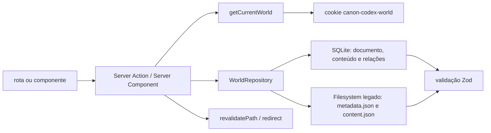

# Visão de arquitetura

A arquitetura mantém a aplicação e os dados locais. As decisões de produto estão nos [ADRs](.).

## Mapa do código

```text
src/app/                         entrada HTTP e navegação Next App Router
  page.tsx                       biblioteca de mundos, independente de mundo ativo
  (wiki)/                        calendário, catálogos e telas de edição/leitura
  actions/                       mutações de negócio via Server Actions
  api/                           upload, leitura de assets, busca e snapshots
src/components/                  UI client/server, Tiptap, tldraw e projeção
src/services/                    casos de uso: mundos, busca e referência de assets
src/domain/                      schemas Zod, tipos e formatos persistidos
src/repositories/contracts/      fronteiras de persistência
src/repositories/sqlite/        driver SQLite padrão
src/repositories/filesystem/    driver JSON legado
src/lib/fs/                      caminhos, existência e escrita atômica
src/lib/migrations/              aplicação lazy de versões
```

`domain/` não faz I/O. Componentes não devem conhecer nomes de arquivos. A factory em
`src/repositories/index.ts` mantém a escolha do driver em um único lugar. No estado atual existem
cinco contratos: `WorldRepository`, `AssetStore`, `BoardRepository`, `SceneRepository` e
`PlaylistRepository`. O SQLite usa `node:sqlite` com Node.js `>=24.15.0`, preferencialmente a versão
24 LTS. O banco padrão é `canon-codex.sqlite` dentro de `WIKI_WORKSPACE_DIR` ou, por padrão, de
`workspace/`. `SQLITE_DATABASE_PATH` seleciona o arquivo diretamente.
`PERSISTENCE_DRIVER=filesystem` seleciona o driver legado. Veja [SQLite local](../data/sqlite.md).

## Caderno do Codex (experimental)

`/codex` é um Server Component que reúne contagens e registros recentes por tipo e entrega ao
`Notebook` (`src/components/codex-notebook/`). O caderno e a mesa são uma cena three.js carregada
só no navegador; as páginas são HTML posicionado sobre as páginas 3D quando paradas e fotografado em
textura quando se movem. A lista de páginas duplas, a geometria, as texturas e as peças de colagem
ficam em módulos separados. Veja o [ADR-007](ADR-007-codex-notebook-home.md).

## Canvas de relacionamentos

`/relationships` entrega relações explícitas entre registros ativos e configurações versionadas do
mundo. `RelationshipView` mantém filtros, ferramentas, painéis HTML e formulários; a cena Konva
mantém câmera, alvos do ponteiro e nós por ID em duas camadas. Armazenamento e formulários
continuam delegando às [Server Actions](../reference/http-and-actions.md).

Máscaras de IDs preservam posições ao filtrar ou recolher pastas. O estado das pastas pertence à
vista do mundo; `RelationshipView` deriva seu indicador externo dos vínculos do recorte atual.
A cena verifica limites de cartões e de curvas
contra o viewport e atualiza apenas as conexões incidentes no arraste. Na visão geral densa,
curvas com o mesmo estilo são desenhadas em lote; vínculos selecionados ou em movimento
mantêm desenho individual. Edições concluídas da vista são agrupadas e gravadas em série usando
a revisão existente.

## Leitura e gravação de entidade



`getCurrentWorld()` lista mundos e lê `canon-codex-world`. Caso o cookie não aponte para um
mundo ativo, usa o primeiro disponível. A função usa `cache()` do React por requisição.

O SQLite consulta registros por ID de mundo e entidade. Criação e edição podem gravar os
metadados e o conteúdo juntos em transação. O repositório lê artigos em lotes ordenados por
ID e retorna metadados, conteúdo e revisão numérica da mesma transação de leitura. Alterações de
metadados ou conteúdo incrementam essa revisão. Backlinks consultam as relações persistidas e os
registros ativos que as contêm.

No filesystem legado, `resolveWorldDir(worldId)` encontra o diretório pelo ID em `world.json`.
`readMigratedJson` valida os metadados e o conteúdo após aplicar as respectivas migrações.
`atomicWriteJson` grava cada arquivo por substituição atômica. Backlinks usam uma varredura das
relações das entidades. Veja [Armazenamento legado](../data/storage.md).

Propriedades declaradas como `kind: 'date'` são a exceção documentada ao antigo campo ISO: a action
e o editor usam `calendar-date.ts` para validar e persistir limites de calendário com a precisão
informada, enquanto o leitor e as páginas especiais compartilham o formatador. Strings ISO legadas
seguem aceitas durante a transição. O adaptador não usa `Date` para anos fictícios nem converte
strings ISO em salvamentos comuns. A tela `/calendar/migration` delega ao `WorldRepository` a prévia,
conversão, retomada e restauração. O SQLite confirma o fingerprint da prévia, grava a conversão
em transação e armazena o histórico para recuperação. O filesystem legado mantém um manifesto
recuperável com os metadados originais e substitui arquivos individualmente. O repositório ainda recusa
mudanças estruturais do calendário se encontrar campos de data preenchidos em registros ativos ou
na lixeira.

No filesystem legado, as operações de conversão e as gravações de entidades/calendário compartilham um lock local por
mundo. Leituras puras (`listWorlds`, `getWorld`, `listEntities`, `listTrashedEntities`, `getEntity`)
usam `withWorldRead` e não tomam o lock, pois cada arquivo é substituído de forma atômica; só o
tomam quando existe backup de origem em `applying`, para aguardar a troca em curso ou recuperá-la
antes de ler. Consultas que reconciliam registros (Linha do Tempo, Evento de origem) continuam
sob o lock. O manifesto de conversão é validado por schema na leitura. A confirmação compara um
fingerprint que inclui entidades, calendário e definições de tipos. Antes de concluir, o adaptador
confere o estado esperado dos arquivos convertidos.

Há uma verificação opcional de concorrência em `EntityPatch.expectedUpdatedAt`; se estiver
desatualizada, `ConcurrentModificationError` impede a gravação. As ações de UI atuais não enviam
esse campo, portanto não há resolução de conflito visual implementada.

O adaptador filesystem também reconcilia ausência definitiva de registros em consultas de linha e
Evento de origem, além da criação de uma origem (`entityLifecycle.ts`). Sob o lock, valida registros ativos, na lixeira e
documentos de linhas antes de limpar aparições em todas as linhas do mundo e o vínculo de origem.
Falhas de inventário interrompem a limpeza. As escritas são atômicas por arquivo, com retomada
idempotente; não há transação entre arquivos ou backup automático. O calendário não é deslocado.
Veja [ciclo de vida](../data/storage.md#reconciliação-de-registros-em-linhas-do-tempo-tl-10).

`getWorld` consulta somente os metadados do mundo e não inicia essa varredura, preservando a
busca global quando uma linha ou registro na lixeira está inválido. A criação de origem reconcilia
o vínculo antes de verificar se já existe um Evento. No SQLite, a reconciliação consulta a existência
dos IDs de origem e aparições e grava as mudanças dentro de uma transação.

Na UI, timelineCanvas.ts calcula coordenadas fixas para todas as aparições, em ordem cronológica.
TimelineCosmicCanvas separa SVG de pontos/conexões memoizado e cartões limitados ao viewport.
useTimelineCamera mantém a câmera em refs, pinta um transform por requestAnimationFrame e
notifica React somente ao cruzar faixas de visibilidade. Filtros são máscaras de IDs, sem alterar
coordenadas/câmera. Biblioteca e navegador têm listas de 50; o mapa não é paginado. A orientação
padrão é horizontal, com alternativa vertical. Distâncias não representam duração proporcional.
O editor único e os demais painéis são sobrepostos. Todos os dados continuam carregados.
Veja [guia](../user-guide/timelines.md) e [decisão visual](ADR-005-design-system.md).

## Fluxo de assets

`POST /api/assets` recebe imagens de MIME suportado e chama `AssetStore.importFromBuffer`.
O repositório atribui um UUID e tenta ler dimensões e gerar a miniatura WebP de até 480 px com
Sharp. Se a miniatura falhar, a importação comum mantém o original com `hasThumbnail: false`.
O upload de fundo de calendário prepara as duas variantes WebP antes da gravação. No SQLite,
a gravação agrupa metadados e binários em uma transação. O filesystem grava os binários no
diretório do asset e publica o documento de metadados em seguida.

A UI guarda o `assetId`. `assetVariantUrl` monta `/api/assets/<assetId>/<variant>` e o handler
consulta bytes e MIME via `AssetStore.getVariant` no mundo ativo. Veja [ADR-003](ADR-003-asset-identifiers.md).

## Mundos e seleção ativa

`src/services/worlds/worldLibrary.ts` coordena criação, descoberta/importação, renomeação e exclusão.
O SQLite cria o mundo semente na inicialização da biblioteca e guarda o calendário no documento do
mundo. O filesystem legado cria o seed se `workspace/worlds/` estiver ausente e guarda o calendário
em `world.json`. Ambos preservam o UUID e o slug quando o nome exibido muda.
No filesystem legado, pastas sem metadados podem ser arquivadas sob demanda em `trash/worlds/`.
Importar copia uma pasta inteira, ajusta slug em colisão de diretório, mas rejeita IDs de mundo já
existentes ou repetidos na mesma importação.

As Server Actions selecionam o mundo por cookie HttpOnly `canon-codex-world`, SameSite `lax`,
caminho `/` e duração de um ano. Excluir o mundo ativo escolhe outro mundo disponível ou apaga o
cookie. A seleção serve ao contexto local de navegação.

A rota `/calendar` lê o mundo ativo. O formulário envia a configuração e o ID do mundo que o
abriu. A Server Action valida o schema e confirma o mundo ativo antes de chamar
`WorldRepository.updateCalendar`. O domínio calcula ordinais, duração de ano, regras intercalares
e formatação de datas fictícias.

## Quadros, cenas e projeção

- Quadros são `BoardDocument`. No filesystem legado, ficam em `boards/<boardId>/board.json`. A página carrega todas as entidades
  como resumos; `InvestigationBoard` guarda o snapshot tldraw por `PUT /api/boards/<boardId>` e
  mantém uma cópia de sessão no `localStorage` do navegador. Imagens inseridas no quadro passam
  pelo mesmo `POST /api/assets`.
- Cenas são `Scene`. No filesystem legado, ficam em `scenes/<sceneId>/scene.json`. Uma cena referencia um local e um asset de
  fundo por UUID, valida a grade, salva snapshots por `PUT /api/scenes/<sceneId>` e pode ser
  duplicada mantendo essas referências e o snapshot. O `SceneRunner` oferece modos preparar,
  mestrar e apresentar.
- A projeção de cena não cria uma sessão no servidor. O mestre abre `/projection/<sessionId>` e os
  dois contextos se conectam ao mesmo `BroadcastChannel` do navegador. O mestre publica estado
  completo e atualizações incrementais; `buildProjectionState` remove tokens/POIs ocultos antes de
  enviar. A janela solicita estado completo se perder uma revisão.
- A projeção de uma entidade abre `/display/entity/<entityId>` em popup e renderiza a mesma tela de
  leitura em modo simples.

## Onde mudar cada coisa

| Mudança | Camada principal | Verificação documental/teste |
| --- | --- | --- |
| Campo persistido/invariante | `src/domain/` + repositório | schema, migração se necessário, round-trip e [modelo de dados SQLite](../data/sqlite.md) |
| Formulário ou layout | `src/components/` e rota correspondente | fluxo no [guia de uso](../user-guide/index.md) |
| Caso de uso de mundo | `src/services/worlds/` + action | testes de `worldLibrary` e guia de mundos |
| Busca | `src/services/search/` + handler | limites em [HTTP e actions](../reference/http-and-actions.md) |
| Persistência | contrato + adaptador em `repositories/` | migração, backup e testes de repositório |
| Upload/asset | `AssetStore`, handler e actions | MIME, thumbnail, privacidade e ADR-003 |
| Quadro/cena | contrato, domínio e componente tldraw | snapshot, exclusão lógica e guia de quadros/cenas |

Se a mudança atravessar uma dessas fronteiras, atualize também a página documental canônica na
mesma tarefa.
