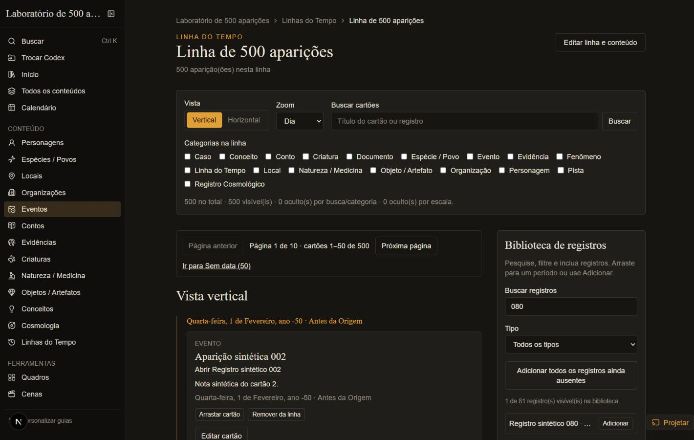
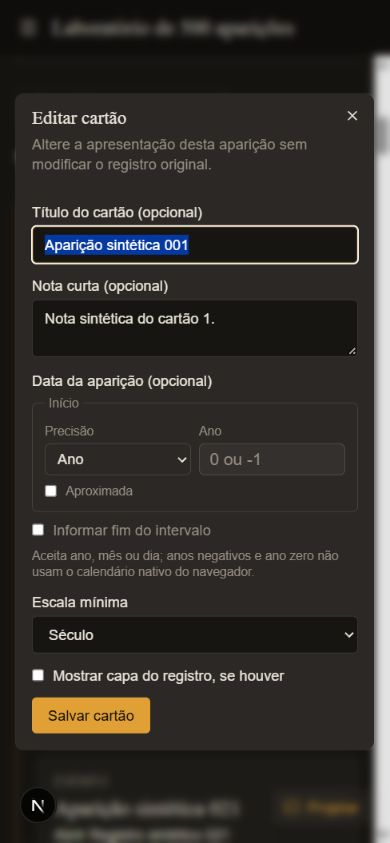
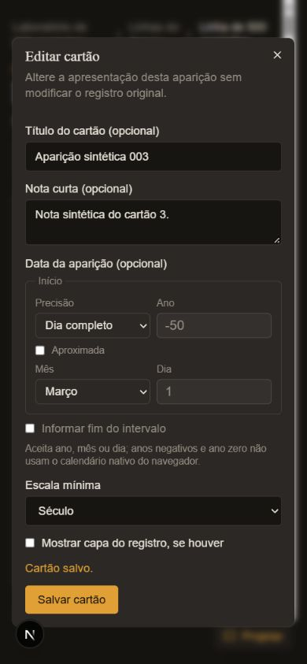

# TL-11 — Perfil de uma linha com 500 aparições

> Relatório histórico. A interface foi substituída em 15/10/2026 pelo
> [Cosmic Canvas](timeline-cosmic-canvas.md); medidas abaixo pertencem à versão anterior.

Verificado em **14/10/2026**, somente com dados sintéticos. O cenário contém 80 registros,
500 aparições (450 datadas e 50 sem data), anos negativos/zero/positivos, intervalos e aproximações.
Cada aparição permite todas as escalas, para medir a situação em que os 500 cartões são visíveis.

## Ambiente e método

- Windows `10.0.26200`, AMD Ryzen 7 5700U, 16 processadores lógicos, aproximadamente 15 GiB de RAM;
- Node `v24.21.0`, Next.js `16.3.4`, React `19.2.8`, `next dev --webpack`;
- navegador embutido do Codex; desktop 1440 × 900 e celular 390 × 844;
- sem simulação de CPU/rede lenta; versão do motor do navegador não registrada;
- Google Fonts indisponível no ambiente: o Next usou fontes de fallback;
- contagem do DOM da aplicação já carregada e tempo de parede da automação ao alternar a vista.
  Esses tempos incluem a comunicação com o navegador e não equivalem a tempo de CPU, INP ou FPS.

A primeira compilação levou cerca de 47 s, incluindo tentativas de baixar fontes, e não foi usada
como medida de navegação. Na versão anterior, a resposta aquecida observada levou 4,5 s e a
automação para alternar a vista atingiu o limite de 3 s. Esse sinal, junto com o DOM abaixo,
identificou a montagem antecipada de todos os editores como o gargalo principal.

Os logs de desenvolvimento variaram entre aproximadamente 2,4 e 40 s por resposta durante a
sessão, que também executou recompilações e verificações. A causa dessa variação não foi isolada;
essas respostas não foram usadas para afirmar ganho no servidor. O resultado abaixo mede a
redução de DOM e a interação no navegador já carregado, não o carregamento frio ou o desempenho
de uma build de produção.

## Resultado

| Medida | Antes | Depois |
| --- | ---: | ---: |
| Cartões montados na página | 500 | 50 |
| Formulários montados, sem editor aberto | 504 | 4 |
| Campos `input/select/textarea` | 9.963 | 63 |
| Elementos no DOM, vista vertical | 41.332 | 1.616 |
| Elementos no DOM, vista horizontal | não obtido | 1.458 |
| Alternância vertical → horizontal, três medições aquecidas | limite de automação de 3 s atingido | 539 / 383 / 395 ms |

A redução de DOM vertical foi de aproximadamente **96%**. As duas vistas e a troca de página
responderam aos comandos sem congelamento observado no ensaio. Não foi coletado perfil de FPS
nem trace de CPU; isso não é uma garantia para outros dispositivos ou linhas com milhares de itens.

## Ajustes e verificações

- Paginação de até 50 cartões após busca, categorias e zoom; mesma ordem nas duas vistas, com
  itens sem data nas páginas finais e acesso direto por **Ir para Sem data**.
- `page` na URL: preservado ao alternar vistas; busca, categoria e zoom reiniciam a página.
- Um único editor em modal, montado apenas ao abrir **Editar cartão**. Edição e gravação verificadas;
  fechar o modal devolve foco ao botão do cartão. A página selecionada continua após a troca de vista.
- Biblioteca com páginas de 50 registros. Busca, filtro e inclusão pelo botão funcionaram na gaveta
  móvel, sem depender de arraste.
- Seleção e índices memoizados; trilhas agrupadas em uma passagem, sem filtrar todos os cartões
  repetidamente para cada trilha.
- Em desktop e celular, a largura do documento igualou a largura do viewport; nenhum campo da
  barra de filtros ou do editor ultrapassou a tela. O eixo mantém rolagem horizontal própria.
- Setas/Home/End no eixo, foco no título após mudar de página, busca sem resultados, busca com um
  resultado, página de 50 itens sem data e preservação de intervalos foram verificados. Nenhuma
  sobreposição de cartões na mesma trilha foi encontrada no cenário.





## Reproduzir

```powershell
node node_modules/vitest/vitest.mjs run --config scripts/vitest.timeline-perf.config.mts
$env:WIKI_WORKSPACE_DIR = Join-Path ([System.IO.Path]::GetTempPath()) 'canon-timeline-performance-tl11'
node node_modules/next/dist/bin/next dev --port 3128 --webpack
```

Abra `http://localhost:3128/entity/30000000-0000-4000-8000-000000000001?scale=day`.
O gerador escreve somente no diretório temporário fixo `canon-timeline-performance-tl11` e
redefine os arquivos sintéticos ao executar novamente. Ele nunca usa o diretório privado padrão.
Use as vistas, páginas e controles da interface para repetir os fluxos. Para contar o DOM em
DevTools, use `document.querySelectorAll('*').length` e, para os cartões,
`document.querySelectorAll('[data-appearance-id]').length`.

## Limites conhecidos e validação

### Correções da revisão TL-11 (14/10/2026)

| Problema reproduzido | Correção e resultado no navegador |
| --- | --- |
| Editar data tira o cartão da página e perde retorno | Ao fechar o editor, a página da aparição é localizada pelo ID na seleção atual. Mover o cartão 002 para o ano 60 abriu a página 9 e focou seu botão. |
| End + Próxima página mantém a rolagem do eixo anterior | A rolagem é reiniciada antes da pintura ao mudar página/busca/categoria/zoom, preservando o contêiner para manter foco de teclado. A página seguinte abre com rolagem zero e primeiro cartão visível. |
| Salvar troca visualmente precisão e mês sem alterar o estado da data | O formulário cancela o reset nativo disparado após a ação React. Precisão `day`, mês `3` e escala `century` permaneceram corretos após salvar sem alterações em tela móvel. |

O mesmo retorno foi verificado na vista horizontal móvel: o cartão 003, movido para o ano 61,
reapareceu na página 9 com foco no botão e sua largura dentro do viewport de 390 px. Se uma
edição de título deixa de corresponder à busca, o editor fecha com aviso explícito de cartão
oculto, sem apagar filtros. Nenhum erro de console foi observado nesses ensaios.
No ensaio final, Voltar pelo histórico também reiniciou a rolagem em zero e manteve foco no
próprio eixo. O retorno após outra edição na horizontal levou ao cartão 004 na página 9.



Os testes de domínio cobrem localização da nova página após edição, mudança para Sem data e
ausência na seleção por busca/escala. As regressões de reset nativo, rolagem e foco foram
verificadas diretamente no navegador; não há suíte de componentes com DOM no runner Node.

### Limites mantidos

A paginação limita o DOM, mas os dados de todas as aparições continuam carregados para filtrar e
ordenar. O eixo horizontal é recalculado para as aparições datadas da página atual. A leitura do
repositório ainda valida o inventário do mundo e as linhas sob lock antes de limpar ausências.
Não foi implementada virtualização por viewport nem busca no servidor. O movimento e o refinamento
visual foram entregues posteriormente no [TL-12](timeline-motion-tl12.md), com medição própria.
Formulários não salvos são descartados ao fechar o editor.

Os testes de paginação percorrem as dez páginas e verificam os 500 IDs, intervalos, ordem, filtros,
URLs, casos vazios e limites inválidos. Os testes de regressão do TL-10 confirmam nova origem após
descarte sem navegação intermediária e busca global disponível com linha corrompida. Suíte completa:
127 testes passaram e 1 falhou no pacote Tal’Dorei (`taldoreiPack.test.ts:49`: 49 relações, expectativa
maior que 100), fora deste fluxo. ESLint de `src/` e `scripts/` passou.
Na checagem final, os testes relacionados passaram, assim como TypeScript e ESLint.

Não houve alteração de schema ou versão persistida, portanto nenhuma migração de dados é
necessária. O uso dos tokens existentes preserva o ADR-005; a mudança de interação está
documentada no guia, e os pontos de reconciliação corrigidos estão no ADR-001 e na referência.
Nesta correção, README, ADRs, migrações e referência de actions não precisaram de nova mudança:
as capacidades gerais, decisões arquiteturais, documentos persistidos, payloads e parâmetros de
URL continuam os mesmos. Guia, PROJECT, testes, ticket e este relatório detalham a interação corrigida.
