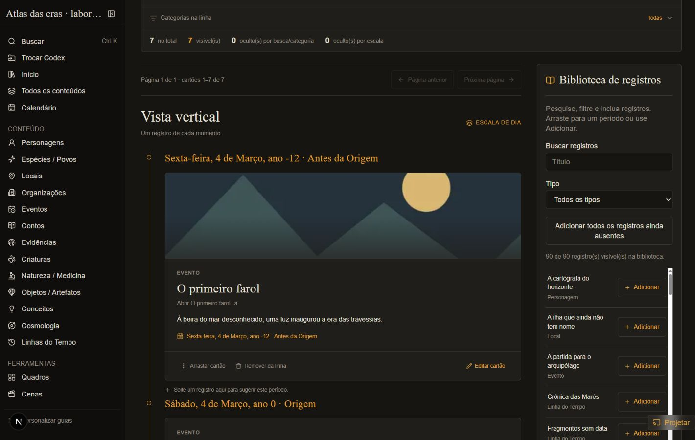
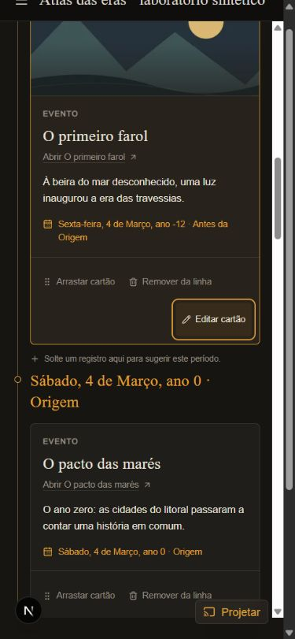

# TL-12 — Apresentação e movimento das Linhas do Tempo

> Relatório histórico. A interface foi substituída em 15/10/2026 pelo
> [Cosmic Canvas](timeline-cosmic-canvas.md); medidas abaixo pertencem à versão anterior.

Verificado em **14/10/2026**, exclusivamente com dados sintéticos fora do diretório privado.
As [referências primárias](../research/timeline-visual-motion.md) orientaram a composição;
o [guia](../user-guide/timelines.md#apresentação-e-movimento) descreve o comportamento entregue.

## Ambiente e método

- Windows 10.0.26200, AMD Ryzen 7 5700U, 16 processadores lógicos, aproximadamente 15 GiB de RAM.
- Node 24.21.0, Next.js 16.3.4, React 19.2.8, build de produção com webpack.
- Navegador integrado, Chromium 155.0.0.0; aplicação em 1440 × 900 e 390 × 844.
- A viewport móvel usa o mesmo computador, sem emulação de CPU/rede ou dispositivo físico.
- O build precisou de acesso de rede para baixar Geist, Geist Mono e Lora do Google Fonts.

O gerador usa 500 aparições, 80 registros-base, 450 cartões datados e 50 sem data, com anos
negativos, zero e positivos, intervalos e aproximações. Todas as aparições permitem todas as escalas.
Uma segunda linha de sete cartões cobre capa sintética, cartões no mesmo período e registro na
lixeira; outras duas linhas cobrem seleção somente sem data e linha vazia.

`scripts/timeline-motion-profile.html` é um instrumento opt-in, separado da aplicação. Carrega a
linha sintética em iframe de mesma origem e usa `requestAnimationFrame`, `PerformanceObserver`
para long tasks/deslocamentos e `document.getAnimations()`. Seu cabeçalho ocupa 100 px; por isso,
a janela de ensaio mede 1440 × 1000 ou 390 × 944, deixando as dimensões acima para a aplicação.

Foram registradas seis alternâncias por viewport e, no celular, paginação, zoom e busca. Cada
amostra acompanha 700 ms depois do primeiro callback de quadro. `nextFrameMs` mede o tempo da
interação até esse callback usando o mesmo relógio monotônico; **não é INP nem prova de pintura
concluída**, pois React ainda pode trabalhar depois dele. Intervalos de quadro usam os timestamps
do próprio rAF. O primeiro intervalo é excluído do percentil e informado separadamente pelo
tempo até o callback. Estes valores não incluem o tempo de comunicação das ferramentas.

## Resultados

| Medida | Desktop, seis alternâncias | Celular, seis alternâncias |
| --- | ---: | ---: |
| Cartões montados | 50 | 50 |
| Tempo até o próximo callback de quadro | 116,2–152,0 ms | 125,0–212,2 ms |
| Percentil 95 dos intervalos, por amostra | 16,9–17,0 ms | 16,8–17,0 ms |
| Maior intervalo observado depois do primeiro callback | 33,3 ms | 50,0 ms |
| Máximo de animações simultâneas na aplicação inteira | 5 | 5 |
| Deslocamentos de layout observados | 0 | 0 |

No celular, a troca de página manteve 50 cartões e foco no título da vista. O próximo callback
ocorreu em 201,9 ms, com p95 de 17,1 ms, maior intervalo de 33,41 ms e pico de 12 animações
na aplicação inteira, incluindo transições de botões/foco. A mudança de zoom teve p95 de 16,9 ms,
mas um intervalo de **183,4 ms** e uma long task de 110 ms. A busca sem resultados teve p95 de
16,8 ms, zero cartões montados e nenhum deslocamento de layout.

Há long tasks de montagem nas alternâncias: 116–151 ms no desktop e 124–210 ms no celular,
além de uma tarefa de 51 ms em uma amostra móvel. Portanto, os quadros da transição ficaram
majoritariamente próximos de 60 Hz neste ensaio, mas **não há garantia de 60 FPS contínuos ou
resposta abaixo de 100 ms**, especialmente na montagem e no zoom.

Dados brutos: [desktop](timeline-motion-tl12-desktop.json), [celular](timeline-motion-tl12-mobile.json)
e [controles móveis](timeline-motion-tl12-controls.json). O último arquivo inclui também as seis
alternâncias móveis para conservar o contexto da sessão. Não há comparação causal de ganho
percentual com o TL-11: aquele relatório usava tempo de automação e desenvolvimento.

## Ajustes entregues

- Eixo vertical contínuo, marcas de período, títulos serifados, ações subordinadas e capas com
  altura reservada. As duas vistas usam os tokens existentes, incluindo no modo claro.
- Categorias recolhíveis; estados vazios com ações distintas; aviso explícito para registro na
  lixeira, conservando nota e data, sem link para um registro indisponível.
- Área horizontal limitada a 70% da altura da tela/44 rem, régua fixa e rolagem nos dois sentidos.
  Isso evita focar o meio de um eixo muito alto e encontrar apenas trilhas vazias.
- Fades de 110 ms para mudanças de contexto/remoção; entrada de 150 ms e 6 px apenas para até
  oito cartões novos visíveis. Sem stagger global, cópias de saída ou centenas de animações.
- Seleção/ordenação das 500 aparições reutilizada ao trocar somente vista/página; geometria da
  página memoizada para evitar recalculá-la ao focar um cartão ou abrir/fechar o editor.
- Rolagem vertical usa a região real do WikiShell. A troca de vista conserva a aparição selecionada
  ou a primeira visível; a mudança explícita de página reinicia o eixo e foca o título.
- `prefers-reduced-motion` cancela Web Animations e elimina transições/rolagem suave, incluindo
  o conteúdo e overlay de modal/gaveta. Os cinco testes novos cobrem preferência, ausência da
  API, cancelamento durante o fade e remoção dos listeners.

## Verificação funcional e visual

Em desktop e viewport móvel foram inspecionados as duas vistas, capas, cartões próximos,
intervalo aproximado, linha vazia, seleção somente sem data, indisponibilidade e busca vazia.
A largura do documento permaneceu dentro da viewport; na horizontal móvel não houve
sobreposição entre cartões da mesma trilha.

Com 500 aparições, End + Próxima página abriu a página 3 com eixo em zero, 50 cartões e foco
em **Vista horizontal**. Abrir/fechar o editor devolveu foco ao mesmo ID; alternar vertical/horizontal
conservou a seleção e trouxe esse cartão ao eixo. A revisão final reproduziu perda de contexto ao
usar Voltar com uma aparição em trilha distante. O retorno passou a localizar o ID selecionado
no DOM da nova vista e posicionar ambos os eixos, sem depender da ordem dos listeners de
histórico do Next.js. Essa regressão foi repetida no navegador depois da correção; as medidas
acima foram coletadas antes desse ajuste de retorno, mantendo a mesma paginação/composição.
**Ir para Sem data** abriu a página 10 com
50 cartões. A busca/categoria manteve a URL e ocultou temporariamente os itens.

Na linha editorial, inclusão pela gaveta seguida de Cancelar manteve os sete IDs e devolveu foco
ao botão da biblioteca. O filtro Evento mostrou quatro cartões; remover e Desfazer mostrou três
e quatro cartões, respectivamente, com os mesmos IDs restaurados. O alvo na lixeira conservou
seu texto e data, sem link para abri-lo.





## Reproduzir

O gerador **apaga e recria somente** o diretório temporário fixo `canon-timeline-visual-tl12`, depois
de validar seu caminho. Não aponte esse nome para dados pessoais. As rotas adicionais ficam no
arquivo sintético `tl12-routes.json` dentro dele.

```powershell
node node_modules/vitest/vitest.mjs run --config scripts/vitest.timeline-visual.config.mts
$env:WIKI_WORKSPACE_DIR = Join-Path ([System.IO.Path]::GetTempPath()) 'canon-timeline-visual-tl12'
node node_modules/next/dist/bin/next build --webpack
New-Item -ItemType Directory -Path public -Force | Out-Null
Copy-Item -LiteralPath scripts/timeline-motion-profile.html -Destination public/timeline-motion-profile.html
node node_modules/next/dist/bin/next start --port 3131
```

Abra `http://localhost:3131/timeline-motion-profile.html` e use os controles da linha. Recarregar
o instrumento limpa suas amostras. Para inspecionar a aplicação sem o instrumento, abra
`http://localhost:3131/entity/30000000-0000-4000-8000-000000000001?scale=day`.
Depois do ensaio, remova apenas a cópia `public/timeline-motion-profile.html`; ela foi removida
da entrega e não faz parte das rotas do produto.

## Qualidade e limites

31 testes relevantes passaram, incluindo cinco novos testes de movimento. TypeScript, lint de
`src/` e `scripts/` e build de produção passaram. A suíte completa teve **132 testes aprovados
e uma falha preexistente** em `taldoreiPack.test.ts:49`: 49 relações no pacote, expectativa maior
que 100. O TL-12 não altera esse pacote nem sua asserção.

Não houve teste em celular físico, auditoria completa WCAG, trace de GPU ou emulação visual da
preferência de movimento do sistema: essa preferência foi verificada nos testes de cancelamento
e na revisão de CSS/rolagem. Uma tentativa de arraste pela automação não abriu a confirmação;
portanto, o gesto nativo continua sem confirmação manual. Os handlers e formatos de arraste
foram preservados, e as alternativas por botão/teclado foram verificadas.

A paginação continua em 50; todas as aparições permanecem carregadas para filtrar e ordenar.
Não há virtualização, busca no servidor ou persistência de seleção/posição entre recarregamentos.
Dados, IDs, datas, ordenação, schemas, migrações, actions e parâmetros de URL não mudam.
README, PROJECT, ADR-005, guia, testes, tickets e esta evidência foram atualizados; ADRs de
armazenamento, documentação de migrações e referência HTTP não precisam mudar porque seus
contratos e decisões continuam iguais.
